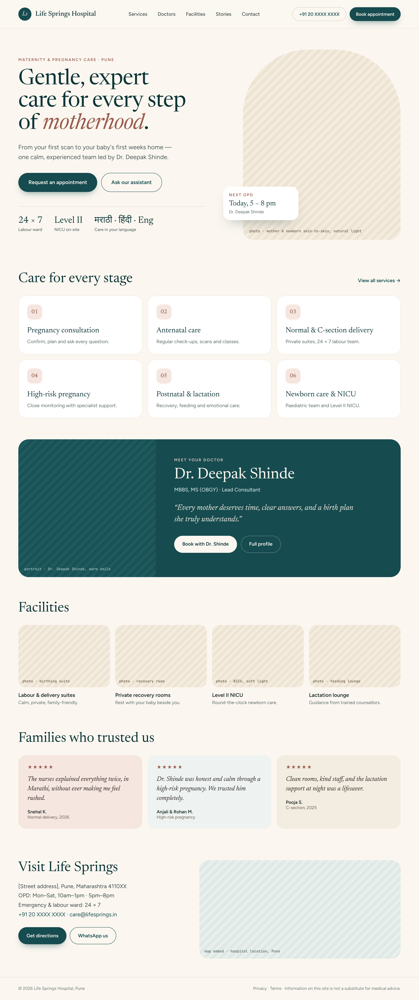
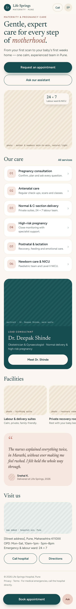
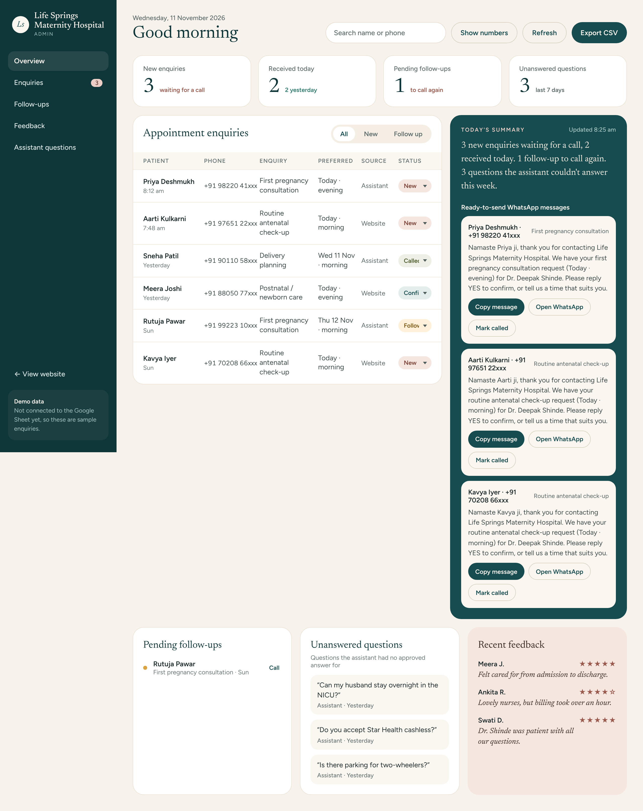
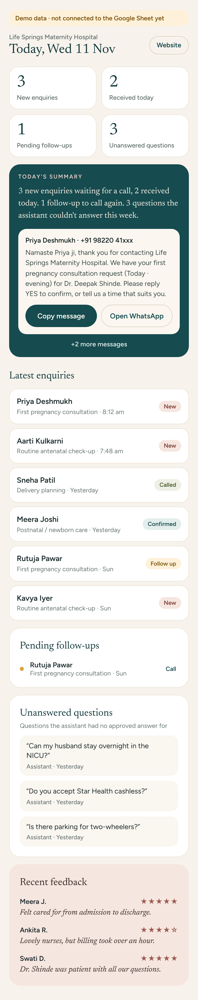

# Life Springs Maternity Hospital

Patient website, AI enquiry assistant and owner dashboard for Life Springs Maternity Hospital, Pune.
Built with React, TypeScript and Vite.

## Run it

```bash
npm install
npm run dev        # http://localhost:5173
npm run build      # type-check + production build to dist/
npm test           # assistant conversation tests + Google Sheets script tests
```

## Pages

| Route          | What it is                                                                 |
| -------------- | -------------------------------------------------------------------------- |
| `/`            | Home: hero, services, doctor, facilities, stories, visit (mobile + desktop) |
| `/doctor`      | Dr. Deepak Shinde's profile                                                 |
| `/appointment` | Appointment request form with confirmation                                  |
| `/assistant`   | Scripted, hospital-approved enquiry assistant (chat)                        |
| `/admin`       | Admin board: enquiries, statuses, WhatsApp drafts (passcode sign-in)        |

## Screenshots

| Desktop | Phone |
| --- | --- |
|  |  |
|  |  |

More in [`docs/screenshots/`](docs/screenshots/).

## Structure

```
src/
  styles/tokens.css     design tokens (colours, type, radii, shadows)
  styles/global.css     base styles, .eyebrow, responsive helpers (.only-mobile / .only-desktop, 900px)
  components/ui/        Button, Logo, PhotoSlot, Eyebrow, BackButton, StatusBadge, Stars
  components/site/      SiteHeader, SiteFooter, MobileActionBar
  pages/                one folder-level component + CSS file per route
  data/hospital.ts      hospital, doctor, services, facilities, testimonials copy
  data/assistant.ts     assistant's approved answers and conversation logic
  data/dashboard.ts     sample dashboard data
  data/images.ts        photos used on the site, with alt text
  lib/api.ts            every call to the backend (Google Sheets today)
  lib/adminSession.ts   admin passcode session, signs out after 30 min idle
apps-script/            the Google Sheets backend (Code.gs) and its tests
```

## Saving enquiries (Google Sheets)

Appointment requests, assistant bookings and unanswered assistant questions are saved to a Google Sheet
through a small Apps Script web app (`apps-script/Code.gs`). The admin board reads them back and can change
their status. **Setup: [docs/GOOGLE_SHEETS_SETUP.md](docs/GOOGLE_SHEETS_SETUP.md).**

Without `VITE_SHEETS_URL` set, the site runs in demo mode: nothing is saved and the admin board shows sample
data. All backend calls live in `src/lib/api.ts`, so a later move to Supabase only touches that file.

## How the assistant works

The assistant (`/assistant`) is **scripted, not an AI model**: every reply is a fixed, hospital-approved
answer chosen by matching keywords in what the visitor types (`src/data/assistant.ts`). For each message it:

1. Shows the labour-ward warning for emergency words (pain, bleeding, medicine…), even mid-booking.
2. Stops a booking on "cancel".
3. Treats the message as the answer if it just asked something (booking details, or "would you like a call back?").
4. Matches approved topics (booking, packing, visiting hours, OPD timings, postnatal care, services, location, phone), then small talk (hi, thanks, bye, help).
5. Otherwise says it has no approved answer and offers a call back.

To change an answer or add a topic, edit `ANSWERS`, `MENU` and the keyword patterns in `RE`, then add a case
to `src/data/assistant.test.ts` and run `npm test`.

## Before launch

- Hospital address and phone number are real. Doctor credentials, email, timings and testimonials are still **placeholder copy** (`src/data/hospital.ts`).
- Photos are temporary Unsplash stock images (`src/assets/images/`, credits in `docs/IMAGE_CREDITS.md`). Replace them with the hospital's own photos, especially Dr. Shinde's portrait.
- Connect the Google Sheet (docs/GOOGLE_SHEETS_SETUP.md) and set `VITE_SHEETS_URL` on your hosting service; otherwise requests are not saved.
